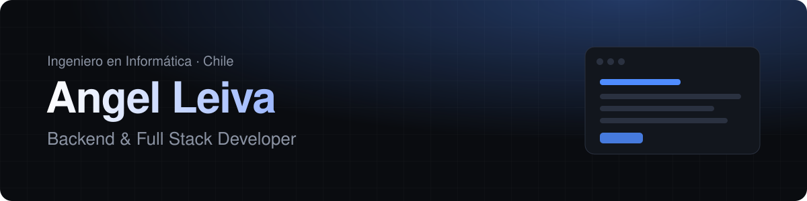

## Sobre mí

Soy Ingeniero en Informática y me especializo en **desarrollo backend y full stack**. Me gusta entender cómo trabaja una organización y convertir sus procesos en sistemas claros, rápidos y fáciles de mantener.

- 🏛️ Desarrollé desde cero la **Plataforma de Documentos de la Municipalidad de Lonquimay**, hoy en producción.
- 🎓 Actualmente acompaño a municipios en la implementación del ecosistema **SGD** en la Universidad de la Frontera.
- 🌱 Profundizando en APIs con **FastAPI**, PostgreSQL y despliegue con Docker.
- 📍 Temuco, Chile · Disponible para nuevas oportunidades.

## Proyectos destacados

| Proyecto | Descripción | Tecnologías |
|---|---|---|
| [**Mesa de Ayuda TI**](https://github.com/angelleiva-dev/mesa-ayuda-api) | API REST para gestionar tickets de soporte con roles, plazos (SLA), notas internas y estadísticas. | Python · FastAPI · PostgreSQL · Docker |
| [**DocuGest**](https://github.com/angelleiva-dev/docugest) · [demo](https://angelleiva-dev.github.io/docugest/) | Sistema de gestión documental para municipios con búsqueda, filtros, vista previa y panel de indicadores. | JavaScript · HTML · CSS |
| [**Portafolio**](https://angelleiva-dev.github.io) | Mi sitio personal con experiencia, proyectos y contacto. | HTML · CSS · JavaScript |

## Tecnologías

## Contacto

